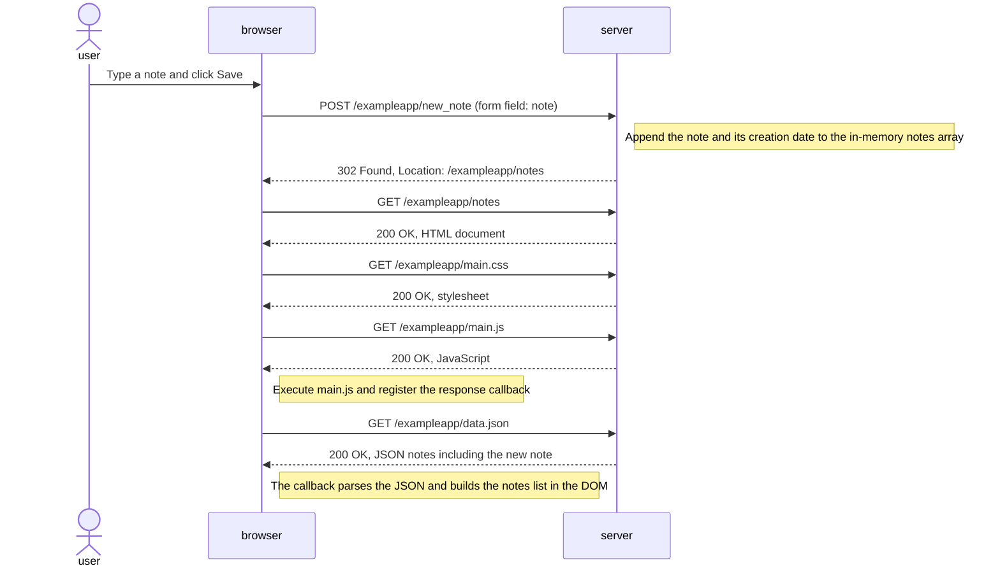

# 0.4 — New note in the traditional notes application

Starting condition: `/exampleapp/notes` is already open. The user types a note and saves the form. Requests below assume caching is disabled, as in the course demonstration.

The POST triggers a redirect and a full document reload. The CSS and JavaScript requests may run concurrently; their drawn order does not imply that one depends on the other. The JSON request is initiated by the downloaded JavaScript.

AI-assisted draft; review before submission.
