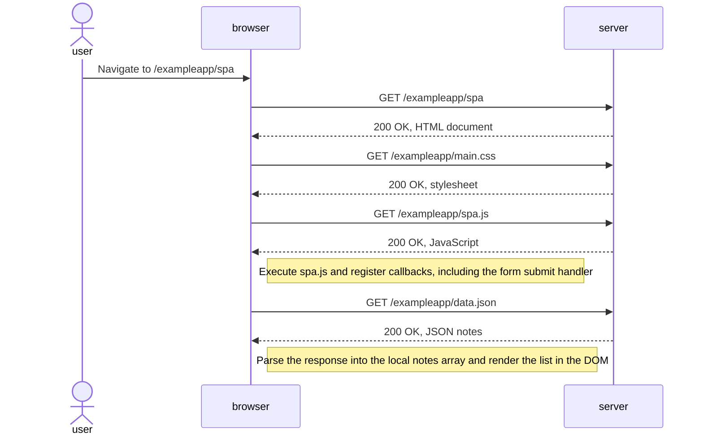

# 0.5 — Loading the single-page notes application

Starting condition: the user navigates to `/exampleapp/spa`, with caching disabled.

The initial load still fetches HTML, CSS, JavaScript, and note data. The SPA behavior becomes especially visible when adding a note: the form handler updates the existing page instead of loading a new document. CSS and JavaScript can be requested concurrently.

AI-assisted draft; review before submission.
